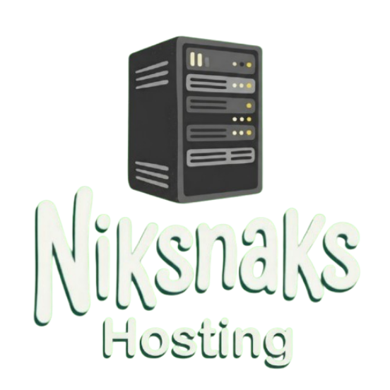
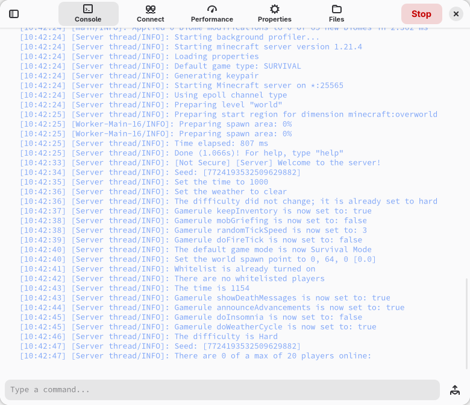
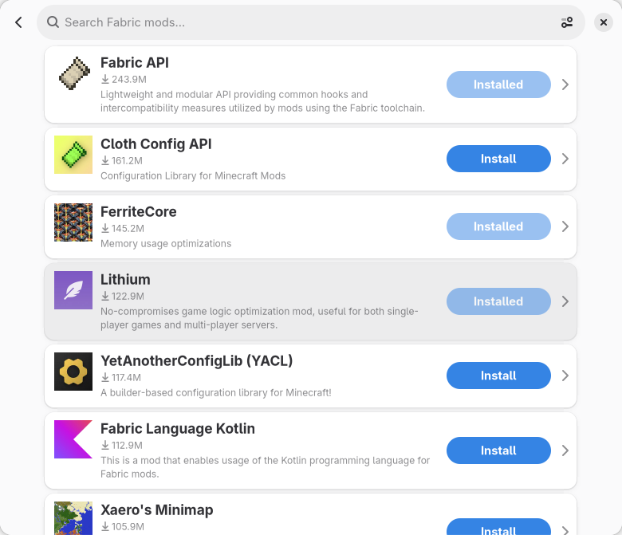
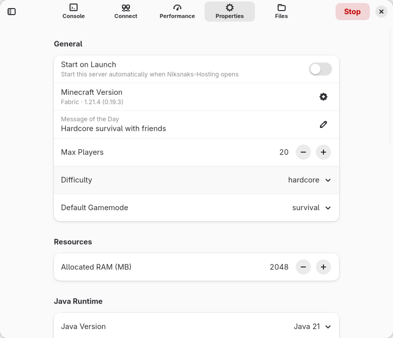
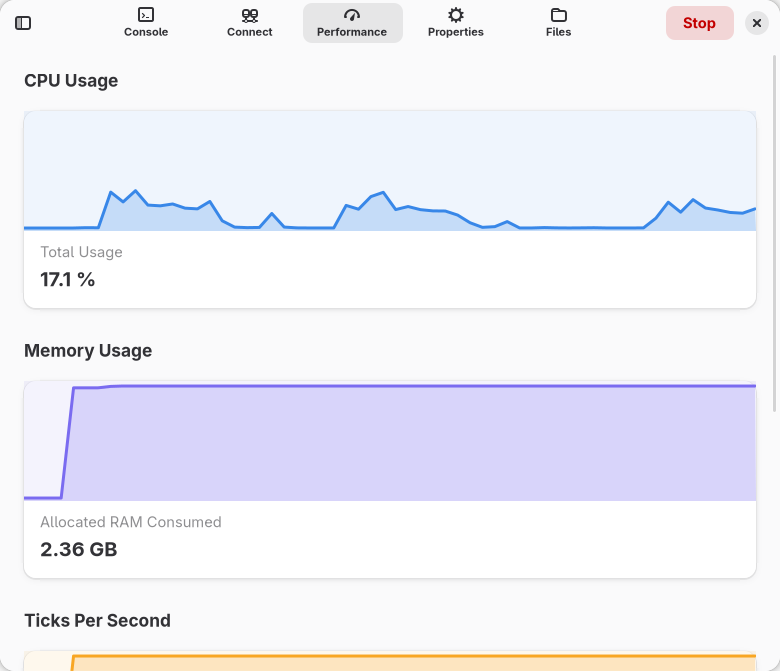
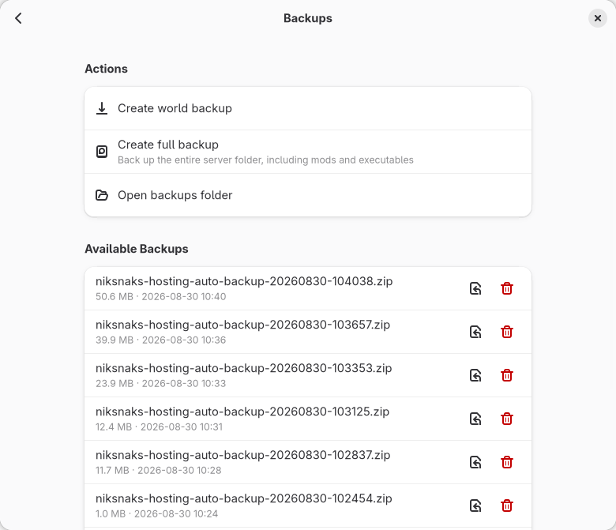
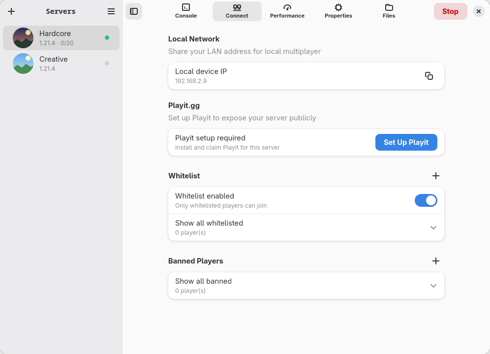

<div align="center">



# Niksnaks-Hosting

### Host your own Minecraft server. No command line required.

A desktop app that creates, runs and looks after Minecraft servers — Java or Bedrock, on
this computer or on another one — and can hand them out to friends through a web panel.

[](LICENSE)
[](https://github.com/Niksnaks3/Niksnaks-hosting/releases)
[](#-installation)
[](https://www.python.org/)
[](https://gtk.org/)
[](#-development)

</div>

---

## What it does

Running a Minecraft server by hand means finding the right server `.jar`, installing a
matching Java, editing config files and remembering which port you used. Niksnaks-Hosting
does that behind a native GNOME-style window, then keeps going once the server is up: a
live console, mod browsers, a properties editor, backups, performance graphs, Playit
tunnels, and — if you want to run it like a small hosting company — a browser panel for
the people you share servers with.

## 📸 Screenshots

<div align="center">

| Console & logs | Install mods | Server properties |
| :---: | :---: | :---: |
|  |  |  |

| Performance | Backups | Connect |
| :---: | :---: | :---: |
|  |  |  |

</div>

## 🚀 Features

### Creating a server

- **One-click setup** — the app downloads the server files and a matching Java runtime.
- **Java or Bedrock** — Bedrock uses Mojang's Bedrock Dedicated Server and gets the same
  console, backups, allow list and properties editor, tuned to Bedrock's settings.
- **Any version, any loader** — pick a Minecraft version, then a **Fabric**, **Forge** or
  **NeoForge** build published for it (the recommended one is preselected).
- **Ports that don't collide** — every server gets its own port; the app suggests the next
  free one and warns before two servers clash.
- **Performance mods** with one switch at creation time.
- **Start from a backup** — build a new server out of a full backup, which doubles as cloning.
- **Run it on another machine** over SSH — see [Servers on other machines](#-servers-on-other-machines).

### Mods, modpacks and worlds

- **Modrinth browser** — search, filter and install mods, modpacks and datapacks, with
  required dependencies resolved for you.
- **CurseForge modpacks** — Fabric, Forge and NeoForge packs in one click, preferring the
  author's server pack when there is one. A pack never lands on the wrong loader: the app
  asks first and switches the server only if you say so.
- **One-click updates** — check every installed mod, modpack and datapack for newer builds
  and apply them together.
- **Worlds** — import existing worlds, browse world files, read the seed.
- **Mod helpers** — Geyser, Floodgate and Simple Voice Chat are configured automatically
  when installed.
- Long installs and restores show a real progress bar with per-file detail.

### Running and sharing

- **Live console** with command input.
- **Performance** — CPU, memory, TPS and uptime.
- **Properties editor** — `server.properties` as a form; comments and unknown keys survive.
- **Players** — whitelist and ban list (Bedrock's allow list included).
- **Backups** — world-only or full-server, restore from any of them, optional clean-up of
  backups older than 30 days.
- **Playit.gg tunnels** — share the server without touching your router.
- **Web panel** — a browser control panel hosted by the app itself; see
  [Web panel](#-web-panel).
- **Per-server Java** — pick a Java version and set JVM arguments.
- **Server icons**, **keyboard shortcuts** (listed in the in-app dialog), and
  **translations** (English and Polish so far; more welcome).

### Quitting, resetting, and where things live

- **Safe quit** — closing the app stops every server running on *this* computer, waits
  for each world to finish saving, and takes the auto backup first. Servers on other
  machines are left running.
- **Reset** (Preferences → Reset) puts the install back to day one: every local server
  with its world, mods and backups, plus settings, Java runtimes and cache. Servers on SSH
  hosts are untouched — the app only stops tracking them — and the app's login key is
  taken back from each host it can still reach.
- Everything the app owns lives in one data folder: `~/.local/share/niksnaks-hosting` on
  Linux (the Flatpak keeps it inside its own `~/.var/app/…` sandbox) and
  `%LOCALAPPDATA%\Niksnaks-Hosting` on Windows.

## 📦 Installation

### Windows

Download `Niksnaks-Hosting-<version>-Setup.exe` from the
[Releases page](https://github.com/Niksnaks3/Niksnaks-hosting/releases) and run it.
From then on the app checks for new versions itself and offers to install them.

<details>
<summary>Building the Windows installer yourself</summary>

Windows builds are frozen with **PyInstaller** and packaged with **Inno Setup 6**. GTK4,
libadwaita and PyGObject must come from the same Python environment; the **MSYS2 UCRT64**
shell is the supported one.

```bash
./packaging/windows/build.sh    # installer lands in dist/
```

</details>

### Linux — Flatpak (recommended)

Download `Niksnaks-Hosting-<version>.flatpak` from the
[Releases page](https://github.com/Niksnaks3/Niksnaks-hosting/releases) and install it:

```bash
flatpak install --user Niksnaks-Hosting-*.flatpak
```

It updates like any other Flatpak — `flatpak update`, GNOME Software, or the **Update**
button the app shows when a new version is out. A copy installed from a bundle made
before updates were added cannot update itself; install the new bundle once with
`--reinstall`.

To build a bundle yourself:

```bash
./packaging/flatpak/build.sh
flatpak install --user dist/Niksnaks-Hosting-*.flatpak
```

`build.sh` pulls in the GNOME runtime and the Python modules and produces a bundle in
`dist/`. While developing, `./packaging/flatpak/dev-update.sh` rebuilds the installed
Flatpak in place.

<details>
<summary>Linux — build from source with Meson</summary>

```bash
meson setup build
ninja -C build
meson install -C build      # installs to the configured prefix
```

This installs the `niksnaks-hosting` command, the desktop entry, icons, metainfo and the
compiled translations.

</details>

### Run from source

```bash
pip install requests psutil pillow tomlkit paramiko
python niksnaks_hosting.py
```

| | |
| --- | --- |
| **Python** | 3.13 or newer |
| **UI toolkit** | GTK 4, libadwaita, PyGObject |
| **Python packages** | `requests`, `psutil`, `Pillow`, `tomlkit`, `paramiko` |
| **Java** | downloaded and managed by the app, per server |

> [!NOTE]
> On Windows, use the Python that has GTK4, libadwaita and PyGObject — the MSYS2 UCRT64
> environment. Frozen builds find their bundled GTK runtime on their own.

## 🎮 Getting started

1. Open **Niksnaks-Hosting** and click **Create Server**.
2. Choose **Java** or **Bedrock**, then a Minecraft version and loader.
3. Accept the port the app suggests, or pick your own.
4. Press **Create**. The app downloads everything and tells you when the server is ready.

From there: install mods, open the **Connect** view for the address to give friends (or a
Playit tunnel), watch the console, edit properties, take backups.

> [!TIP]
> **Bedrock is not Java.** Bedrock servers run Mojang's native Bedrock Dedicated Server:
> no loader, no heap size, no Modrinth mods, and the app hides those options. Bedrock
> players connect over **UDP** on the server's port (19132 by default) plus the next port
> up for IPv6. The **Connect** view spells out the exact address.

## 🖥 Servers on other machines

Add a computer over SSH — Windows or Linux — from the create-server wizard, give its
password once, and the app installs its own key so it never asks again. From then on:

- The app installs Java and the loader on the host and runs the server there — as a
  systemd user service on Linux or a Scheduled Task on Windows — and streams its console
  back. Closing the app here never stops a server over there.
- If Niksnaks-Hosting is already installed on that machine, the app asks it which servers
  it runs and offers to **adopt** them. A server created from here is written into the
  host's own server list, so it shows up in the app on that machine too, and renames,
  icons and deletions follow in both directions.
- Either end can drive a server: a server folder carries its own console, so whichever
  copy of the app started it, the other one still sees it running, reads its log, sends
  commands and can stop it.
- Removing a host drops its servers from the local list without touching the machine;
  **Clear all hosts** does the same for every host and revokes the login key where it can.

## 🌐 Web panel

Open the main menu (☰) → **Web panel…** and switch on **Host the web panel**. The app
listens on the port you choose (8080 by default) and shows the address other machines on
your network can open, with a copy button. In the same dialog, add a login for each person
and tick the servers they may control; an **Administrator** sees all of them.

The site is laid out like a classic hosting panel (in the spirit of Crafty Controller),
drawn in the app's own colours:

- **Dashboard** — the host's CPU and memory, how many servers are online, how many players
  are on, and an *All servers* table with start/stop/restart buttons, live CPU and memory
  bars, players, port, version and status.
- **Server page** — a details card (status, started, uptime, CPU, memory, players, TPS,
  version, loader, port, memory limit) and four tabs:
  - **Terminal** — the live console with coloured log levels, a command box with ↑/↓
    history, Start/Restart/Stop, and a *Jump to latest* button when you've scrolled up.
  - **Metrics** — tiles plus two minutes of CPU, memory, TPS and player graphs.
  - **Mods** — the installed list, removal with dependency clean-up, and Modrinth search
    and install, filtered to the server's Minecraft version and loader.
  - **Settings** — its picture (the one shown in the app and in Minecraft's server
    list), its message of the day, and the version updater — pick a newer Minecraft
    version and loader build, and the app makes a full backup, reinstalls the server and
    moves mods that no longer fit aside, exactly as the app's own updater does.

A Bedrock server gets the same Settings tab: its picture, its server name (Bedrock's
version of the message of the day) and an updater that installs Mojang's newer Bedrock
build while keeping worlds, server.properties and the allow list. Only the Mods tab is
hidden for it. A Java server on another machine can have its picture and message of the
day changed from the panel, but not its version: that install would run on the wrong
computer, so the panel says so instead. A Bedrock server on another machine can be
updated, since that host downloads its own build, but no backup is made first.

After the app is updated, an open panel tab reloads itself the next time it talks to the
app, so nobody is left on the old page.

Starting a server from the panel goes through the same checks as the app's Start button.
For a server on another machine, CPU, memory and uptime are not available; the rest is.
The page follows the browser's light or dark preference and works on phones. The panel
runs inside the app, so it is up while the app is — including with the window closed into
the background — and stops when you quit.

> [!IMPORTANT]
> The panel speaks plain HTTP and is meant for your own network. Before exposing it to the
> internet, put a reverse proxy with HTTPS in front (Caddy or nginx are a few lines each)
> and forward only that. Anyone you give a server to can run any console command on it, so
> treat a login like a key. Logins are stored hashed in `web_users.json` in the data folder.
> Windows may ask to allow the app through the firewall the first time it starts.

## 🛠 Development

**Ruff** (line length 120, `py313`) and **mypy** check the code; the tests need no GTK:

```bash
ruff check .
python -m unittest
```

See [CONTRIBUTING.md](CONTRIBUTING.md) for the workflow before opening a patch.

### Releasing

Pushing a tag builds both versions on GitHub Actions
([`release.yml`](.github/workflows/release.yml)), publishes the GitHub Release with the
Windows installer and the Flatpak bundle, and updates the Flatpak repo on GitHub Pages
that installed copies update from.

1. Raise `__version__` in `niksnaks_hosting/version.py`.
2. Commit, then tag and push:

   ```bash
   git tag Release-1.6.0 && git push origin Release-1.6.0
   ```

One-time setup:

- **GitHub Pages** — after the first release has run, go to *Settings → Pages* and
  publish from the `gh-pages` branch, folder `/ (root)`.
- **Signing (recommended)** — create a GPG key without a passphrase and save its private
  key as the repository secret `FLATPAK_GPG_PRIVATE_KEY`:

  ```bash
  gpg --batch --passphrase '' --quick-gen-key "Niksnaks-Hosting Flatpak" ed25519 sign never
  gpg --armor --export-secret-keys "Niksnaks-Hosting Flatpak"
  ```

  Add it before the first release: copies installed from an unsigned bundle never
  check signatures.

### Project layout

```
niksnaks_hosting.py        # Entry point; sets up the GTK environment for frozen builds
niksnaks_hosting/
├── factory.py             # App factory
├── i18n.py                # gettext setup and language switching
├── version.py             # Single source of the version number
├── gtk_ui/                # GTK4/libadwaita UI
│   ├── dialogs/           # create server, preferences, hosts, web panel, progress, …
│   └── views/             # console, performance, properties, files, connect, sidebar
├── web/                   # Browser control panel: stdlib HTTP server, auth, SSE,
│   └── static/            # and the single-page app it serves (vanilla HTML/CSS/JS)
└── shared/
    ├── backend/           # server_manager, server_process, stats, mod_installer,
    │                      # java_manager, modrinth_client, curseforge_client,
    │                      # download_manager, playit_manager, bedrock_manager, …
    ├── remote/            # SSH hosts: key auth, Windows/Linux ops, adoption
    └── core/              # event bus
tests/                     # unittest suite (web panel, mod bookkeeping)
po/                        # Translations (.pot, .po, LINGUAS, POTFILES)
packaging/                 # Flatpak, Linux desktop files, Windows installer
meson.build                # Build definition
```

### Built with the help of Claude Code

Parts of this project were developed with [**Claude Code**](https://claude.com/claude-code),
Anthropic's agentic coding tool, used as a pair-programming assistant for implementing
features, profiling hot paths and writing the tests that verify them. Every change was
reviewed and tested before landing.

## 🌍 Translations

Strings are marked with `_("...")` and go through Python's standard `gettext`. To add or
update a language, generate the `.pot`, create or update a `.po`, add the locale to
`po/LINGUAS` and send it along — the steps are in [CONTRIBUTING.md](CONTRIBUTING.md).

## 🤝 Contributing

Bug reports, translations and patches are all welcome. Please read
[CONTRIBUTING.md](CONTRIBUTING.md) first.

## 📄 License

Free software under **GPL-3.0-or-later**. See [LICENSE](LICENSE).

## 💙 Acknowledgements

Developed by **[niksnaks3](https://github.com/Niksnaks3)**.

Thanks to [Modrinth](https://modrinth.com), [CurseForge](https://www.curseforge.com) and
[Playit.gg](https://playit.gg), whose APIs make key features possible, to
[Crafty Controller](https://gitlab.com/crafty-controller/crafty-4) for the panel layout
the web panel takes after, and to the GTK and GNOME projects for the toolkit.

Minecraft is a trademark of Mojang Studios. This project is not affiliated with or endorsed
by Mojang Studios or Microsoft.

<div align="center">
<br />
<sub>Built for people who just want to play with their friends.</sub>
</div>
